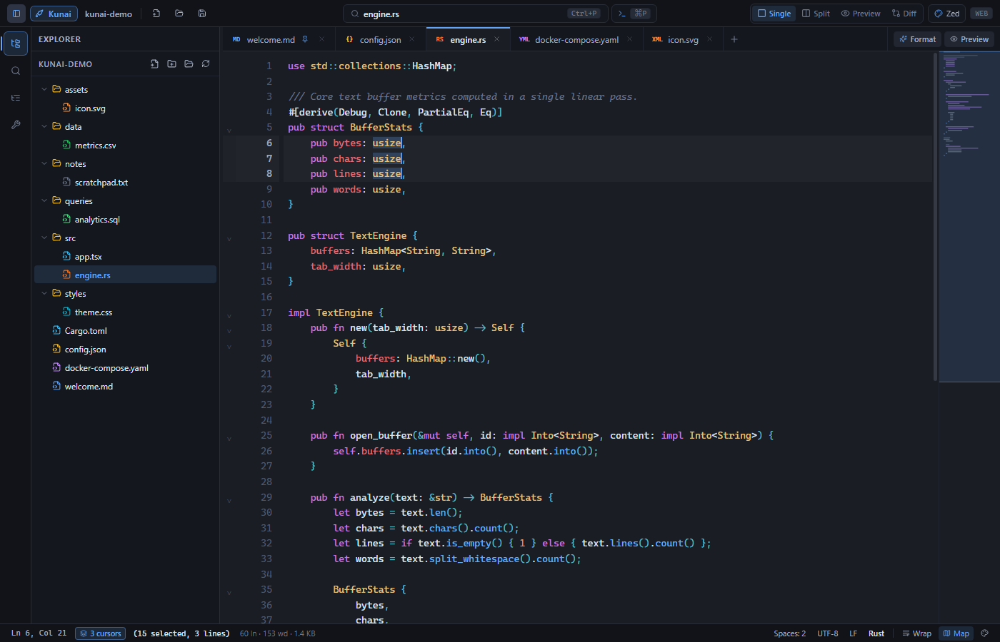
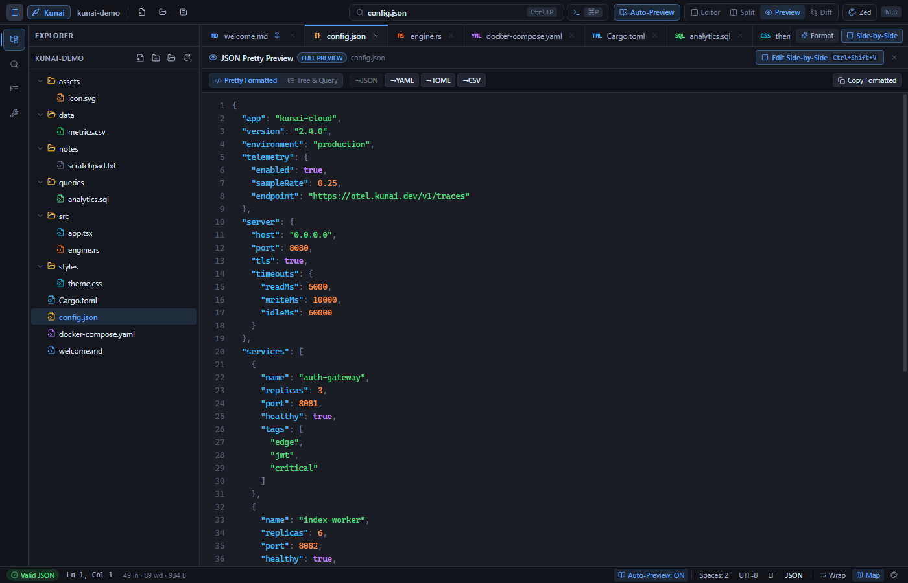
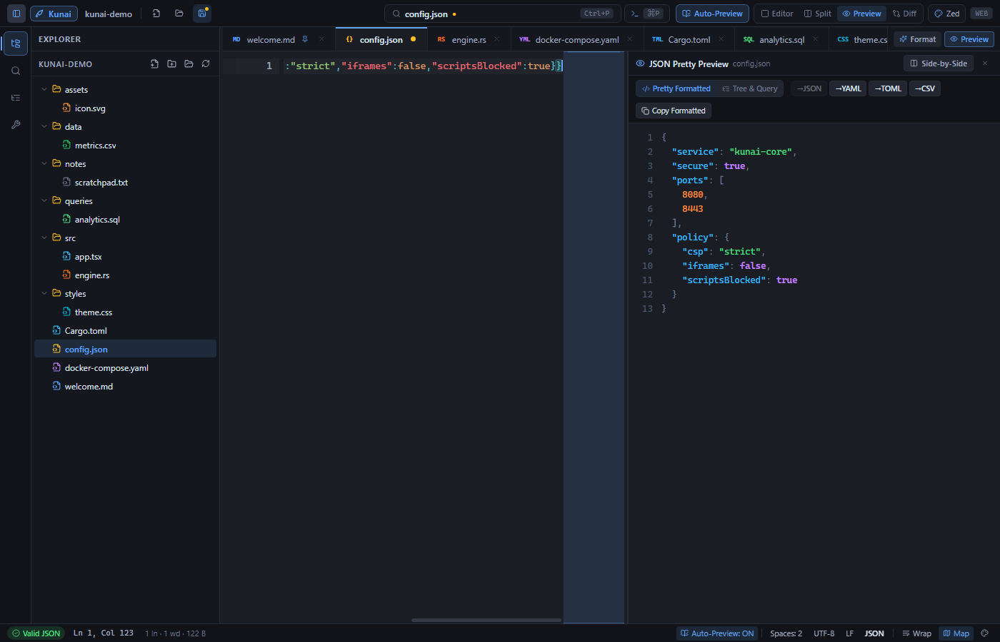
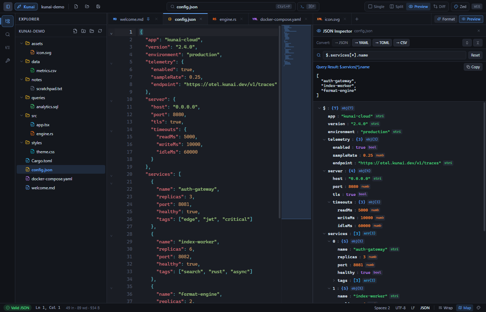
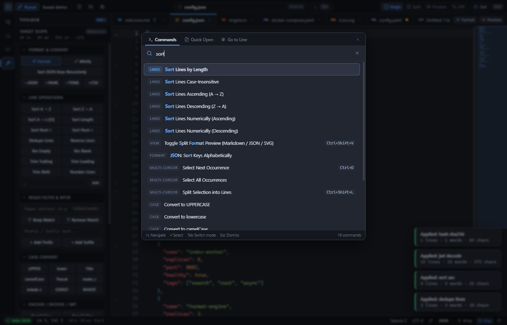
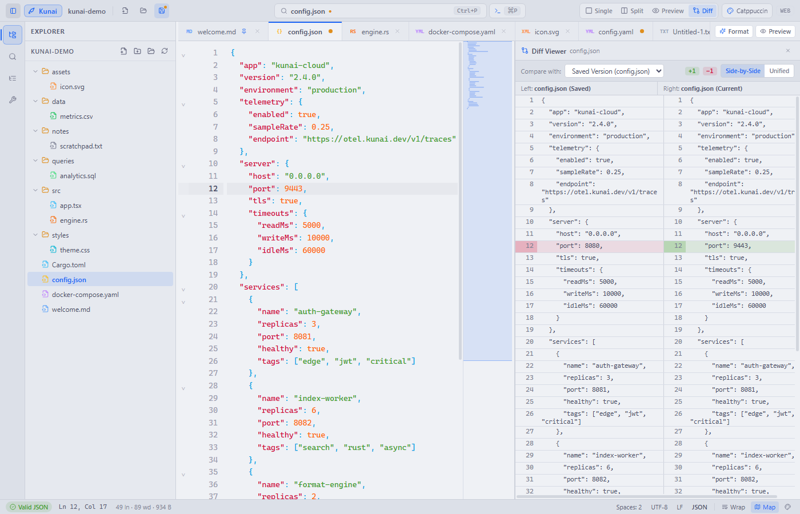
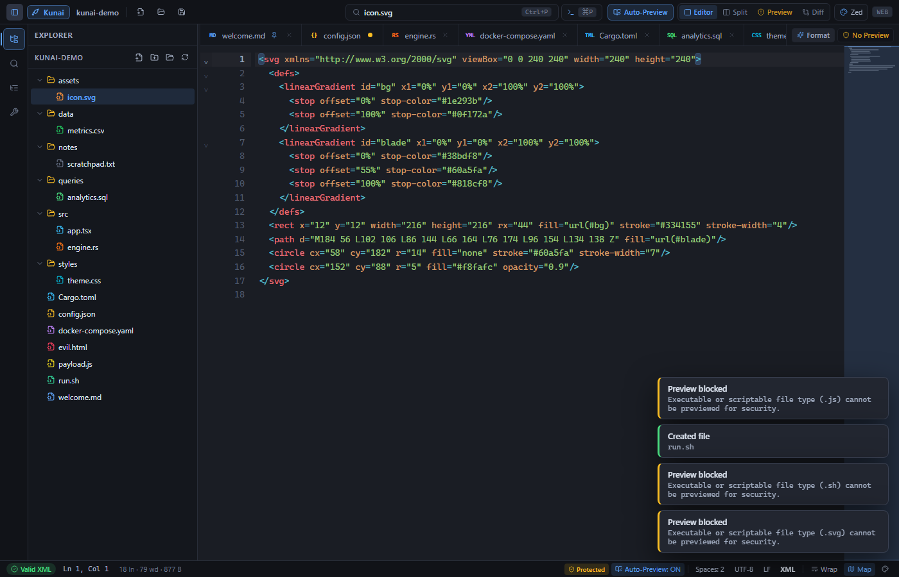

# Kunai

**Kunai** is a fast, secure, Rust + Tauri v2 smart code & text editor inspired by **Sublime Text**, **Zed**, and **Notepad++** — with true multi-cursor editing, modern language & web format support, secure pretty-printed previews, and built-in developer utilities.



---

## Screenshots

### Always-Preview Mode & Side-by-Side Pretty Formatting (`Ctrl+Shift+V`)
Open safe structured formats directly in full-pane pretty-printed preview (`Auto-Preview`), then press `Ctrl+Shift+V` to edit raw/minified markup alongside a live pretty-printed preview:





### Interactive JSON / YAML / TOML Tree Inspector & JSONPath Query
Inspect nested data structures, run live JSONPath queries (`$.services[*].name`), and convert between JSON, YAML, TOML, and CSV in one click:



### Command Palette (`Ctrl+Shift+P`) & Notepad++ Utility Toolbox
Fuzzy-search commands or apply instant line, case, regex filter, Base64/URL/JWT, and hash transforms directly to your selection or buffer:



### Catppuccin Latte Light Theme & Side-by-Side Diff Viewer
Compare against saved versions, other open tabs, or clipboard with side-by-side and unified diff views across 4 built-in themes:



### Built-in Script & Executable Preview Protection
Scriptable and executable files (`.html`, `.svg`, `.js`, `.ts`, `.sh`, `.rs`, etc.) are strictly blocked from preview — zero `<iframe>` or script execution:



---

## Key Features

### Multi-Cursor & Sublime / Zed Editing
- **True Multi-Cursor Editing**:
  - `Ctrl+D` — Select next occurrence
  - `Ctrl+Shift+L` — Split selection into lines
  - `Alt+Click` — Add cursor at click
  - `Alt+Drag` — Column / rectangular box selection
  - `Ctrl+Alt+Up` / `Ctrl+Alt+Down` — Add cursor above / below
  - `Alt+Up` / `Alt+Down` — Move lines up / down
  - `Alt+Shift+Up` / `Alt+Shift+Down` — Duplicate lines
  - `Ctrl+Shift+K` — Delete line
  - `Ctrl+/` — Toggle comment
- **Command Palette & Navigation**:
  - `Ctrl+Shift+P` — Fuzzy Command Palette
  - `Ctrl+P` — Quick Open workspace files
  - `Ctrl+G` — Go to line
  - `Ctrl+F` / `Ctrl+H` — Regex, Case, Whole-Word, and In-Selection Find & Replace
  - `Ctrl+Shift+F` — Fast Rust workspace-wide search
- **Sublime-Style Minimap**, code folding, bracket matching, indent guides, multi-tab pinning, and 4 built-in themes (**Zed One Dark**, **Sublime Mariana**, **Tokyo Night**, **Catppuccin Latte**).

### Modern Formats & Secure Pretty Previews
- **Always Open in Preview (`Ctrl+Alt+P`)**: Persisted toggle that automatically opens safe formats in clean full-pane preview.
- **Quick Side-by-Side Toggle (`Ctrl+Shift+V`)**: Instantly toggles between **Markup + Preview Side-by-Side** and Full Preview / Editor.
- **Pretty-Printed Previews on All Safe Native Formats**:
  - **Markdown** (strictly DOM-sanitized GFM)
  - **JSON / YAML / TOML** (pretty-printed formatted view + Interactive Tree Inspector + live **JSONPath** query + 1-click JSON ↔ YAML ↔ TOML ↔ CSV conversion)
  - **XML / CSS / SQL** (pretty-printed, indented, syntax-colored text preview)
  - **CSV / TSV** (aligned pretty text + escaped Data Table)
  - **Fast Sandboxed PDF Viewer**: HiDPI lazy canvas rendering (`IntersectionObserver`), offline bundled PDF.js worker, thumbnails & bookmarks rail, `Fit Width` / `Fit Page` / `Ctrl+Wheel` zoom, rotation, in-PDF full-text search (`Ctrl+F`), split-pane PDF + notes/code, and 1-click **Extract Text to Tab** — zero `<iframe>` and PDF scripting disabled.
- **Live Linting & Validation**: Real-time line/column diagnostics for JSON, YAML, TOML, and XML.

### Notepad++ Power Utilities (Native Rust Engine)
- **Line Operations**: Sort (A→Z, Z→A, case-insensitive, numeric asc/desc, by length), Deduplicate, Remove Empty/Blank lines, Trim Leading/Trailing/Both, Reverse, Join, Number lines, Regex Keep/Remove Filter, Add Prefix/Suffix.
- **Case Conversions**: `UPPER`, `lower`, `Title`, `camelCase`, `PascalCase`, `snake_case`, `kebab-case`, `SCREAMING_SNAKE`, `iNVERT`.
- **Web, Encoding & Crypto**: Base64, URL, HTML entities, Hex, Unicode escape, JSON escape & recursive key sort, **JWT Decoder**, **MD5 / SHA-1 / SHA-256 / SHA-512**, UUID v4 generator, Unix Timestamp ↔ ISO-8601.
- **Diff Viewer**: Side-by-side and unified diff against saved versions, other open tabs, or clipboard.
- **Smart File I/O**: Automatic encoding detection & round-trip writing (`UTF-8`, `UTF-8-BOM`, `UTF-16LE`, `UTF-16BE`, `Windows-1252`) and line-ending conversion (`LF`, `CRLF`, `CR`).

### Security by Design
- **Executable / Scriptable Files Never Previewed**: Enforces a strict safe-format allowlist and a 60+ extension denylist (`.html`, `.svg`, `.js`, `.ts`, `.tsx`, `.mdx`, `.sh`, `.ps1`, `.bat`, `.py`, `.rs`, `.php`, `.exe`, etc.) — zero `<iframe>` or `srcDoc` anywhere in the app.
- **Strict DOM Allowlist Markdown Sanitizer**: Strips `<script>`, `<style>`, `<iframe>`, `<svg>`, `<math>`, `<object>`, `<embed>`, `<form>`, `on*` event handlers, and `javascript:` / `vbscript:` / `data:` URLs.
- **Strict Tauri v2 CSP**: `script-src 'self'; frame-src 'none'; object-src 'none'; base-uri 'none'; form-action 'none'`.
- **Rust Backend Hardening**: 1 MiB ReDoS regex size/DFA limits, file size safety caps, NUL-byte path rejection, and XXE-safe XML formatting.

---

## Development & Build

### Prerequisites
- [Rust](https://rustup.rs/) (1.80+) & Cargo
- [Node.js](https://nodejs.org/) (20+) & npm
- WebView2 Runtime (pre-installed on Windows 10/11)

### Install Dependencies
```bash
npm install
```

### Run Desktop App (Hot-Reload Dev)
```bash
npm run tauri:dev
```

### Build Standalone Desktop Executable / Installer
```bash
npm run tauri:build
```

Or build the standalone binary directly:
```bash
npm run build
cargo build --release --manifest-path src-tauri/Cargo.toml --features custom-protocol
```

### Run Tests & Typecheck
```bash
npm run typecheck
cargo test --manifest-path src-tauri/Cargo.toml
```

### Run Web Preview (Browser Fallback Mode)
```bash
npm run dev
```

---

## Tech Stack
- **Backend**: Rust, Tauri v2, `serde`, `serde_json`, `serde_yaml`, `toml`, `quick-xml`, `similar`, `encoding_rs`, `walkdir`, `regex`, `sha2`, `md-5`, `uuid`, `chrono`
- **Frontend**: React 18, TypeScript, Vite, CodeMirror 6, `lucide-react`, `marked`, `js-yaml`
